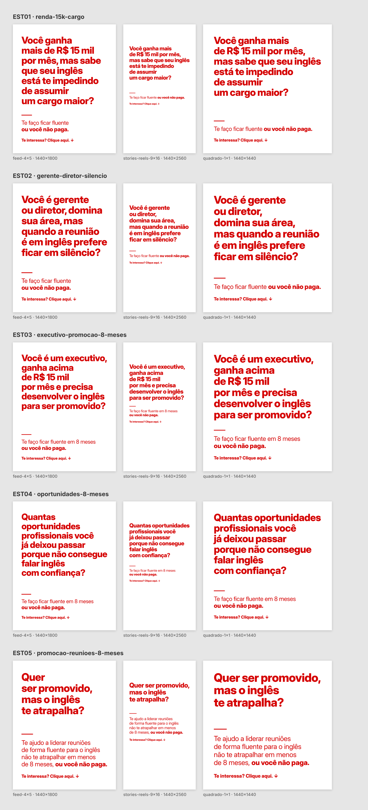

# Criativos estáticos: fundo branco, letra vermelha (outubro/2026)

5 criativos × 3 formatos = 15 PNGs, prontos para o Gerenciador de Anúncios da
Meta. O texto é o dos 5 anúncios do mapa "1. Fazer 5 criativos estáticos". Do
mapa só mudaram a grafia de "executivo" e a vírgula antes de "mas" no EST05.



## Qual arquivo vai em cada posicionamento

| Arquivo | Proporção | Pixels | Onde usar |
| --- | --- | --- | --- |
| `ESTxx_feed-4x5_1440x1800.png` | 4:5 | 1440×1800 | Feeds do Facebook e do Instagram, Explorar, Marketplace |
| `ESTxx_stories-reels-9x16_1440x2560.png` | 9:16 | 1440×2560 | Stories e Reels do Facebook e do Instagram |
| `ESTxx_quadrado-1x1_1440x1440.png` | 1:1 | 1440×1440 | Qualquer posicionamento que a prévia mostre cortado em quadrado |

Os tamanhos são os que o Meta Ads Guide recomenda hoje: 4:5 em 1440×1800 no
feed e 9:16 em 1440×2560 em Stories/Reels ([Feed][guia-feed],
[Stories][guia-stories]). O mínimo da Meta é bem menor; 1440 de largura é o
recomendado.

## Como subir sem cortar o texto

A peça é só texto. Se a Meta recortar ou cobrir a imagem, ela corta a frase.

1. No anúncio, use mídia por posicionamento: 4:5 nos feeds, 9:16 em Stories e
   Reels, 1:1 no que sobrar. Não deixe a Meta adaptar uma imagem só para todos.
2. Nos aprimoramentos automáticos do Advantage+ creative, desligue os que
   mexem na imagem (expandir, recortar, sobrepor texto ou elementos, animar,
   gerar variações). Os nomes mudam com frequência na interface: a regra é
   nenhum aprimoramento que altere a imagem.
3. Antes de publicar, confira a prévia de cada posicionamento e a guia de zona
   segura do Gerenciador.

## Rastreamento por criativo

O botão do SDR na LP já repassa o `utm_content` para a mensagem do WhatsApp.
Com o nome do anúncio igual ao ID do criativo (por exemplo,
`EST01_renda-15k-cargo`) e `utm_content={{ad.name}}` nos parâmetros de URL
([parâmetros dinâmicos da Meta][parametros]), o SDR vê de qual peça o lead
veio sem perguntar. Dê o nome antes de publicar: o `{{ad.name}}` guarda o nome
da primeira publicação, e renomear depois não muda o parâmetro.

## Especificações

- PNG, RGB, de 120 a 150 KB cada (limite da Meta: 30 MB).
- Fundo `#FFFFFF`, texto `#D50000`: contraste de 5,5:1, acima do mínimo AA
  (4,5:1). O vermelho puro `#FF0000` dá 4,0:1 e vibra na tela.
- Fonte: Inter Display, a mesma família da LP, em dois pesos (400 e 800).
- Margens: 120 px nas laterais em todos os formatos.
- Zona segura do 9:16: a Meta pede livres cerca de 14% do topo (358 px), 35%
  da base (896 px) e 6% de cada lado (86 px). Todo o texto do 9:16 fica entre
  418 px do topo e 956 px da base, com 120 px nas laterais.

## Texto de cada peça

| ID | Gancho | Promessa |
| --- | --- | --- |
| EST01 `renda-15k-cargo` | Você ganha mais de R$ 15 mil por mês, mas sabe que seu inglês está te impedindo de assumir um cargo maior? | Te faço ficar fluente ou você não paga. |
| EST02 `gerente-diretor-silencio` | Você é gerente ou diretor, domina sua área, mas quando a reunião é em inglês prefere ficar em silêncio? | Te faço ficar fluente ou você não paga. |
| EST03 `executivo-promocao-8-meses` | Você é um executivo, ganha acima de R$ 15 mil por mês e precisa desenvolver o inglês para ser promovido? | Te faço ficar fluente em 8 meses ou você não paga. |
| EST04 `oportunidades-8-meses` | Quantas oportunidades profissionais você já deixou passar porque não consegue falar inglês com confiança? | Te faço ficar fluente em 8 meses ou você não paga. |
| EST05 `promocao-reunioes-8-meses` | Quer ser promovido, mas o inglês te atrapalha? | Te ajudo a liderar reuniões de forma fluente para o inglês não te atrapalhar em menos de 8 meses, ou você não paga. |

Todas fecham com "Te interessa? Clique aqui. ↓".

## Como mudar o texto e gerar de novo

O texto fica em `fonte/criativos.json` (`*trecho*` sai em negrito). O desenho
fica em `fonte/molde.html`. Para gerar os 15 PNGs e a prévia:

```sh
node criativos/2026-10_estaticos-branco-vermelho/fonte/gerar.cjs
```

Com `--guias=<pasta>`, grava também cópias com a zona segura desenhada, para
conferência; elas não vão para `exportados/`.

O molde escolhe sozinho o corpo da letra e as quebras de linha: equilibra o
comprimento das linhas, não deixa linha terminar em palavra fraca ("de", "o",
"um", "não") nem a última linha curta demais, e aceita letra um pouco menor
para quebrar melhor. Texto novo sai com o mesmo cuidado, sem ajuste à mão.

Precisa do Playwright com Chromium (`npm install` e, fora do ambiente de
nuvem, `npx playwright install chromium`). A fonte vai junto, em
`fonte/fontes/` (licença OFL em `OFL.txt`): o resultado é o mesmo em
qualquer máquina.

[guia-feed]: https://www.facebook.com/business/ads-guide/update/image/facebook-feed/link-clicks
[guia-stories]: https://www.facebook.com/business/ads-guide/update/image/instagram-story
[parametros]: https://www.facebook.com/business/help/2360940870872492
